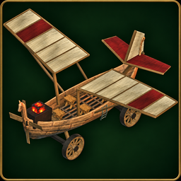

# Surtling Skyfarer

A wooden, Surtling-powered airplane for Valheim. Bring **one pilot and four
passengers**, roll down a runway on wagon wheels, and carry supplies in a
cargo chest upgradeable from 10 to 30 slots.



**Current version: 0.1.8** · [Download](https://github.com/alsocat/SurtlingSkyfarer/releases/latest)
· [Report a bug](https://github.com/alsocat/SurtlingSkyfarer/issues)
· [View the in-game aircraft](https://raw.githubusercontent.com/alsocat/SurtlingSkyfarer/main/media/skyfarer.png)

## New in 0.1.8: upgrades and vertical takeoff

Expand cargo to **20 or 30 slots**, bind a **Wisp** to clear nearby Mistlands
mist, and press **V at the helm** for vertical takeoff and hover. VTOL is
available by default and can be disabled in the config. Reverse now works on
water, too. **Shift + E on the unoccupied helm** opens upgrades and an unstuck
action that lifts and levels a parked aircraft when there is clear space above.

This release separates overlapping wing surfaces and replaces the wing's
building material to address flashing and weather-related whitening. It also
stops distant aircraft physics from running without loaded terrain, protecting
parked aircraft when you leave and return to their area.

Durability remains **off by default**. Existing aircraft, cargo and custom
settings carry forward; update every client and the server together.

## Features

- Wooden boat hull, cloth wings, glowing Surtling core, and a carved propeller.
- Five seats: one pilot and four passengers.
- Four wagon wheels with suspension, steering, brakes, and land/water reverse.
- Full loops, barrel rolls, and rudder control.
- Throttle stays set while someone remains seated or standing on deck. When
  everyone leaves, power cuts out and the plane slows and descends.
- **10 storage slots**, upgradeable to **20 or 30** per aircraft. Cargo saves
  with the plane and drops when you dismantle it.
- Optional bound wisp clears mist within **25 metres** of the plane.
- Toggleable vertical takeoff/hover and a collision-checked unstuck action.
- An **indestructible-by-default** hull, optional configurable durability, and unlimited core power. Collisions still apply;
  hammer dismantling remains available. The hull floats for water landings.

## Requirements

Install these on **every player's computer and on the server**:

| Dependency | Tested version | Download and setup |
| --- | --- | --- |
| BepInExPack Valheim | **5.4.2351** | [BepInExPack Valheim](https://thunderstore.io/c/valheim/p/denikson/BepInExPack_Valheim/) |
| Jötunn, the Valheim Library | **2.30.2** | [Jötunn](https://thunderstore.io/c/valheim/p/ValheimModding/Jotunn/) |
| Surtling Skyfarer | **0.1.8** | [GitHub releases](https://github.com/alsocat/SurtlingSkyfarer/releases/latest) |

Use the same Skyfarer version on all clients and the server. This release was
tested with the **Valheim l-1.0.21 client** and **l-1.0.21 dedicated server**,
both using Unity **6000.0.75f1**.

The Skyfarer download contains the mod itself. Install BepInEx and Jötunn
separately; their files are not bundled. The package manifest declares both
dependencies for Thunderstore-compatible mod managers.

## Installation

### Manual installation

1. Close Valheim, or stop the dedicated server.
2. Install **BepInExPack Valheim** using its instructions for your operating
   system. Launch once through BepInEx so its folders are created, then close it.
3. Install **Jötunn** into the active `BepInEx/plugins` folder.
4. Download `SurtlingSkyfarer-0.1.8.zip` from
   [Releases](https://github.com/alsocat/SurtlingSkyfarer/releases/latest).
5. Extract its `BepInEx` folder into the game or server folder. The mod DLL
   should end up at:

   ```text
   BepInEx/plugins/Skyfarer/Wise.Skyfarer.dll
   ```

6. Launch through your normal BepInEx-enabled method. On Linux, follow the
   BepInEx pack's game or dedicated-server launcher instructions.

If you download the standalone DLL instead, put it in the same folder above.
Keep **one copy** of `Wise.Skyfarer.dll` in your active plugin tree.

### Mod-manager profiles

Install the two dependencies in your Valheim profile, then import the release
ZIP using the manager's local-mod import option. If local import is unavailable,
open the profile folder and copy the DLL into its `BepInEx/plugins/Skyfarer`
folder. Start the game through that modded profile.

### Dedicated servers and AMP

The server needs all three components too. Stop it, install or enable its
BepInEx setup, and upload Jötunn and Skyfarer into its active
`BepInEx/plugins` folder. In AMP, use the instance's File Manager and restart
through its BepInEx-enabled launch method. The same Skyfarer DLL is used by
Windows and Linux clients and servers.

### Updating an existing installation

Stop the server and close each player's game. Replace the existing
`Wise.Skyfarer.dll`, then restart everyone on the same version. Updating from
an earlier release to 0.1.8 does not require reinstalling BepInEx or Jötunn
when the tested versions above are already installed. Existing aircraft gain
the cargo chest when loaded.

## Build the plane

Equip a **hammer**, stand near a **workbench**, and open **Transport**. Look for
**Surtling Skyfarer**, or type `Skyfarer` into the hammer menu's search field.
Your character must discover the recipe materials first.

| Material | Amount |
| --- | ---: |
| Fine Wood | 80 |
| Copper | 25 |
| Deer Hide | 20 |
| Surtling Core | 8 |

## Edit VTOL, durability, health, recipe, and speed

Open `BepInEx/plugins/Skyfarer/Skyfarer.cfg` with any text editor **before
starting the game or server**. Keep it beside `Wise.Skyfarer.dll`:

```ini
[Aircraft]
VtolEnabled = true
DurabilityEnabled = false
MaxHealth = 1800
TopSpeed = 22
Recipe = FineWood:80,Copper:25,DeerHide:20,SurtlingCore:8
```

`VtolEnabled = true` allows the pilot to toggle VTOL with V. Set it to `false`
to disable VTOL for everyone on that server. Conventional flight remains available.

`DurabilityEnabled = false` keeps the plane immune to damage. Set it to `true`
to allow damage and destruction. `MaxHealth` sets its maximum health, from **1
to 1000000**, with **1800** as the default. Use the hammer to repair damage.
Structural and roof-exposure wear remain disabled so flight needs no building
supports or roof. Changing the maximum preserves current health percentage;
disabling durability prevents further damage but does not heal existing damage.

Older config files automatically gain missing settings on startup without
changing your existing values or comments. You can also add `VtolEnabled = true`
under `[Aircraft]` before starting the updated game/server.

`TopSpeed` is the powered target in metres per second, from **10 to 100**.
It affects forward flight and wheel drive; reverse stays at 4 m/s. Dedicated
servers may struggle at 100 m/s; lower it if you notice lag or rubber-banding. Falling and
collisions can briefly exceed this target. Use a dot for decimal values.

`Recipe` accepts comma-separated **item prefab names and amounts**. You can
change quantities or substitute materials, for example
`Wood:100,Iron:30,SurtlingCore:8`. Names are case-sensitive. Use 1–16 distinct
items, each with 1–10000 units. Invalid recipes fall back to the defaults and
write a warning to the log. Characters still need to discover the materials.
Dismantling refunds use the currently configured recipe, including old planes.

Restart after edits. In multiplayer, edit the **server's** file: its settings
are synchronized to clients through Jötunn. Local games use the local file.
Settings apply to all Skyfarers, including existing ones. If the file is missing,
the mod creates it with defaults. Preserve your edited file when updating.

## Controls

| Input | Action |
| --- | --- |
| E on the front chair | Sit in the pilot seat |
| E on a rear chair | Ride as a passenger |
| Hold Shift / Ctrl | Raise / lower throttle |
| W / S | Pitch nose down / nose up |
| A / D | Roll in flight; steer wheels on land |
| Q / E while piloting | Rudder; also steers wheels on land |
| Hold R | Reverse on land or water, up to 4 m/s |
| V at the helm | Toggle VTOL / conventional flight |
| Shift + E on the unoccupied helm | Open upgrades and unstuck services |
| Hold right mouse button | Wheel brakes / stop water reverse |
| Space | Leave the seat |
| E on the cargo chest | Open storage |

**Space is the only manual pilot exit.** E becomes rudder while piloting;
attacking, dodging, and crouching do not eject the pilot.

- **Take off:** line up on open ground, increase throttle with Shift, then
  pull up with S as speed builds.
- **Cruise:** release Shift/Ctrl to hold throttle. Release the flight controls
  to hold the current attitude; there is no automatic leveling.
- **Acrobatics:** keep holding W/S for continuous loops, or A/D for rolls.
- **Land:** level the wings, lower the nose with W, reduce throttle with Ctrl,
  then brake with right mouse after touching down.
- **Reverse:** hold R on the ground or while floating. Releasing R resumes the selected throttle;
  brakes override reverse. R has no effect on thrust in the air.
- **Park:** lower throttle to zero. An empty aircraft cuts power automatically,
  and boarding it again leaves the engine off until throttle is raised.

These controls assume default game bindings. Throttle, pitch, roll, brakes,
and dismount use their corresponding game actions; Q/E, R and V are dedicated keys.

## VTOL and upgrades

**VTOL:** board the helm and press V. Shift rises, Ctrl descends, W/S moves
forward/back, and A/D or Q/E turns. Release the controls to hover. VTOL levels
the wings, climbs/descends at up to 4 m/s and moves horizontally at up to 5 m/s.
Press V again for conventional flight, then raise throttle with Shift. Leaving
the pilot seat ends active hover; park and land before stepping off.

**Upgrades:** put the materials in the aircraft's cargo chest, close the chest,
then stand near the unoccupied front chair and press Shift + E. Choose:

- **Expand cargo:** 20 Fine Wood + 10 Copper per expansion. The first gives
  20 slots, the second 30. Each plane tracks its own upgrades.
- **Bind Wisp:** costs 1 Wisp. A visible wisp clears nearby Mistlands mist while
  following the aircraft; it does not reveal the whole biome or map.

Upgrades and items in the added slots persist through travel, ownership changes
and world saves. Upgrade materials are consumed and are not refunded when the
plane is dismantled; the remaining cargo still drops normally. Close the menu
with its Close button or Escape.

**Unstuck:** stop the engine, have everyone step off, open the same services
menu and choose Unstuck. It searches 2.5–8 metres above the plane for room for
the whole aircraft, levels it, and stops its motion. It refuses occupied or
moving planes, blocked destinations and repeated use within ten seconds. It
respects ward access. If no clear position is available, clear some branches
or obstacles and try again. It does not retrieve already-missing aircraft.

## Changes in 0.1.6

- Fix hammer dismantling by enabling removal on the aircraft prefab. Aim at the
  hull while everyone is off the plane and a workbench is in range. Normal ward
  protection still applies; cargo drops when the aircraft is dismantled.
- Add `Skyfarer.cfg` beside the DLL for custom recipes and powered top speed.
- Keep the current recipe and 22 m/s speed as defaults.

See the [changelog](https://github.com/alsocat/SurtlingSkyfarer/blob/main/CHANGELOG.md)
for earlier versions.

## Testing and support

Version 0.1.5 was tested with Windows and Linux clients on a dedicated server
with four people. Version 0.1.8 passed **193 gameplay regression checks**,
**45 feature checks**, **25 separate-process reload checks**, and **6 dedicated
server startup/shutdown checks** on Linux Valheim l-1.0.21. The wing rendering
was also inspected in a game-rendered preview. A new multi-client flight and
Windows runtime test have not been performed for this update.

If the plane is missing, check the hammer's Transport category, discovered
materials, and `BepInEx/LogOutput.log`. A successful load includes:

```text
Loading [Surtling Skyfarer 0.1.8]
Skyfarer registered: 1 pilot, 4 passenger seats, 13.3 m wingspan.
```

For connection problems, compare Valheim and mod versions on every client and
the server, and check for duplicate DLLs. Report bugs through
[GitHub Issues](https://github.com/alsocat/SurtlingSkyfarer/issues) with versions,
steps to reproduce, and relevant log excerpts. Remove server passwords and
other personal information before posting logs.

## Source and building

The C# source is in [`src/`](https://github.com/alsocat/SurtlingSkyfarer/tree/main/src).
See [Building from source](https://github.com/alsocat/SurtlingSkyfarer/blob/main/docs/BUILDING.md)
for the .NET SDK and local game references, and
[Publishing](https://github.com/alsocat/SurtlingSkyfarer/blob/main/docs/PUBLISHING.md)
for recreating the GitHub/Thunderstore package.

Unofficial community mod, unaffiliated with Iron Gate. Each player needs their
own installed copy of Valheim. Game assemblies, extracted game assets,
dependency binaries, and development saves are not included in the mod package.

## License

Copyright (C) 2026 alsocat and moderncanvas.

Surtling Skyfarer is free software under the
[GNU General Public License v3.0](https://github.com/alsocat/SurtlingSkyfarer/blob/main/LICENSE).
You may fork, modify, and redistribute it, including as part of another mod,
as long as you credit the original authors, link back to this repository, and
release your modified source under the same license. Builds published without
their source are not permitted.
